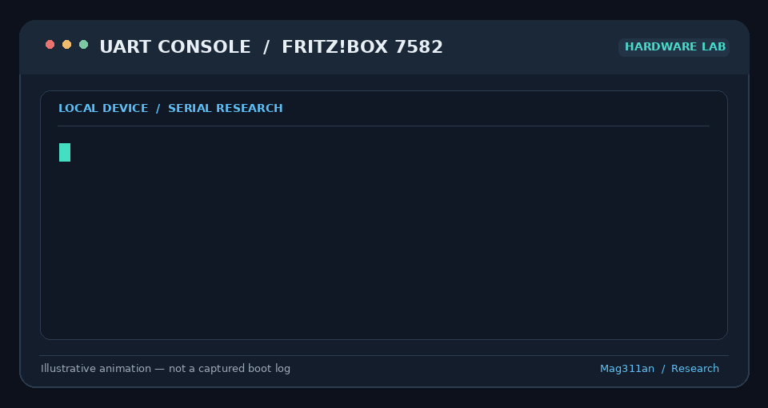
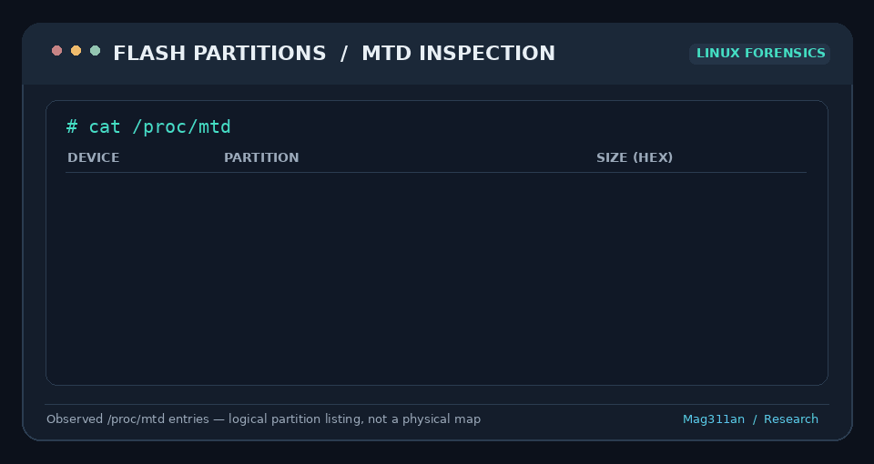

# 🔐 FRITZ!Box Embedded Linux Security Research

**Hardware Security · Embedded Linux · UART · Firmware Analysis · Reverse Engineering**

> 🧪 Independent research on devices I own or am authorized to test. Findings are documented as observed; no remote exploitation or CVE is claimed.

## 👋 Overview

This repository documents hands-on investigation of AVM FRITZ!Box embedded Linux systems. It focuses on physical debugging interfaces, serial console access, boot diagnostics, Linux internals, flash partitions, and firmware reverse engineering.

My goal is to turn experiments into **reproducible technical notes** that demonstrate hardware troubleshooting, security methodology, and embedded Linux knowledge.

## 🔌 Research 01 — UART Console (FRITZ!Box 7582)



Using a **Raspberry Pi Pico** as a serial interface to the tested FRITZ!Box 7582, I established UART communication at **115200 baud, 8N1** and obtained an interactive shell.

### ✅ Verified observations

- Captured output from the embedded Linux boot process.
- Reached an interactive local shell through physical UART access.
- Verified effective root identity with `id`:

```text
uid=0(root) gid=0(root)
```

> 📌 The animation is **illustrative**, not a recording of the actual device session. Physical root-shell access does **not** by itself demonstrate remote code execution, persistence, or a CVE.

## 💾 Research 02 — MTD Flash Layout (FRITZ!Box 7582)



Examined `/proc/mtd` to identify logical flash partitions exposed by the operating system.

| Partition | Label | Size (hex) |
|---|---|---|
| `mtd0` | `kernel` | `0x00400000` |
| `mtd1` | `urlader` | `0x00200000` |
| `mtd2` | `nand-tffs` | `0x00400000` |
| `mtd3` | `reserved-kernel` | `0x00400000` |
| `mtd4` | `nvram` | `0x00020000` |
| `mtd5` | `ubi` | `0x1f0e0000` |
| `mtd6` | `filesystem` | `0x03013000` |
| `mtd7` | `reserved-filesystem` | `0x03013000` |
| `mtd8` | `config` | `0x0020f000` |
| `mtd9` | `nand-filesystem` | `0x17536000` |

> 📝 These are **observed MTD entries**, not a visualization of contiguous physical flash addresses. Some layers can describe overlapping storage regions.

## 🧩 Research 03 — Firmware Analysis (FRITZ!Box 7583)

A **separate** firmware investigation has involved:

- 📦 SquashFS filesystem inspection
- 🧠 MIPS big-endian executable analysis
- 🔎 Embedded libraries, services, and binaries
- 🛠️ Static analysis of firmware components

The 7582 hardware session and 7583 firmware analysis are **distinct experiments**. Results are not interchangeable.

## 🛠️ Tools & Technologies

`Ubuntu` · `Embedded Linux` · `Raspberry Pi Pico` · `MicroPython` · `UART` · `Bash` · `Python` · `MTD` · `UBI` · `SquashFS` · `MIPS`

## 🎯 Next Research Steps

- [ ] 📷 Add annotated photos of the physical lab setup
- [ ] 📚 Document UART wiring and serial configuration
- [ ] 🧾 Publish sanitized session notes and evidence
- [ ] 🗂️ Expand filesystem and boot-process analysis
- [ ] 🛡️ Assess security implications without overstating findings

## ⚖️ Responsible Research

All research is conducted on hardware I control or am authorized to examine. Public materials omit private keys, credentials, unique device identifiers, and exploit details that require coordinated disclosure. Proprietary firmware images are not redistributed.

## 👨‍💻 Author

**Mag311an** · B.Sc. Engineering Physics · Independent Hardware & IoT Security Researcher

🔗 [GitHub profile](https://github.com/Mag311an)
