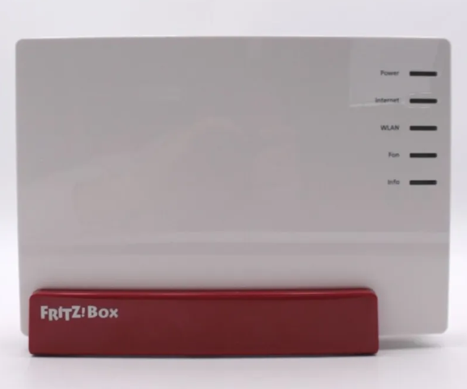
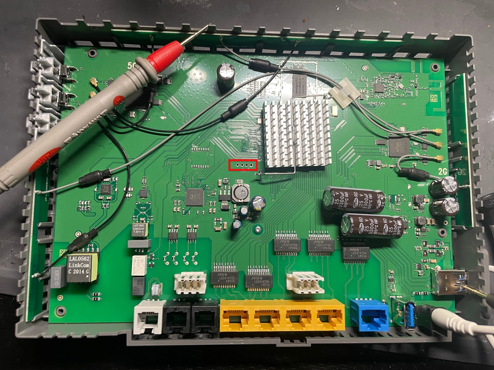
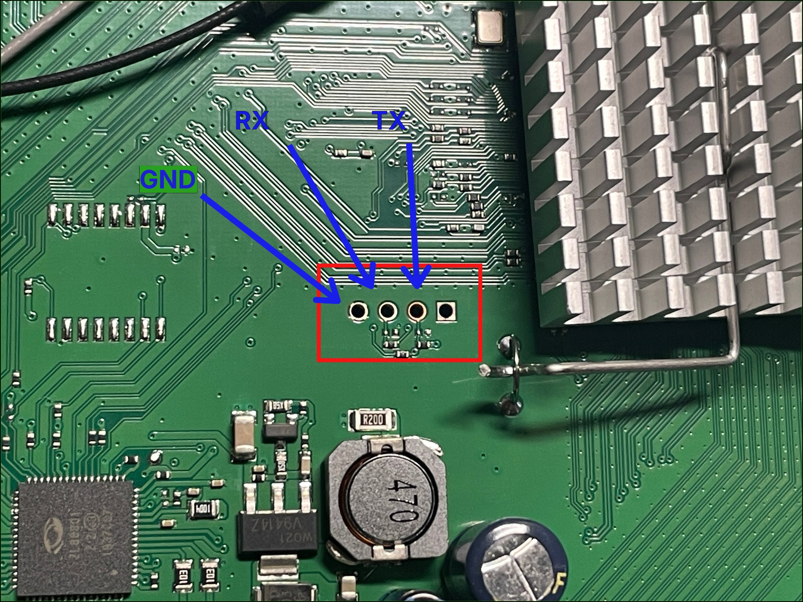
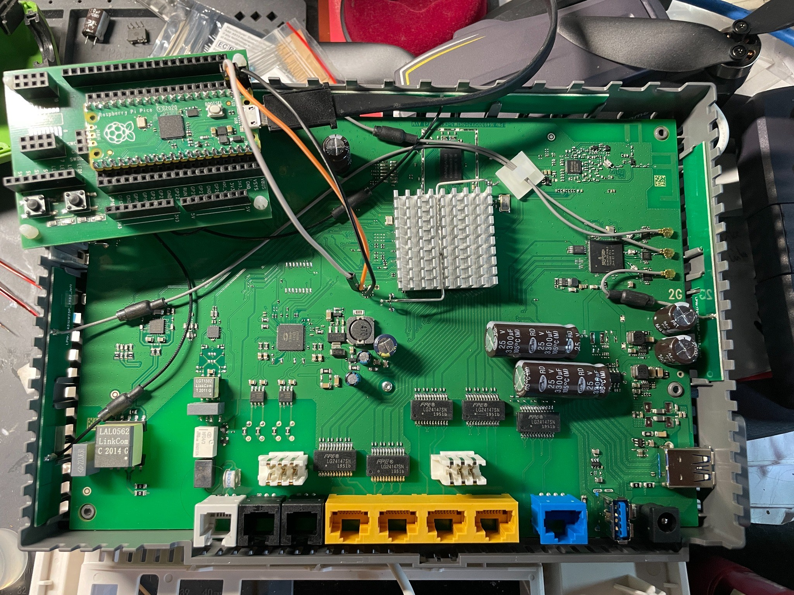
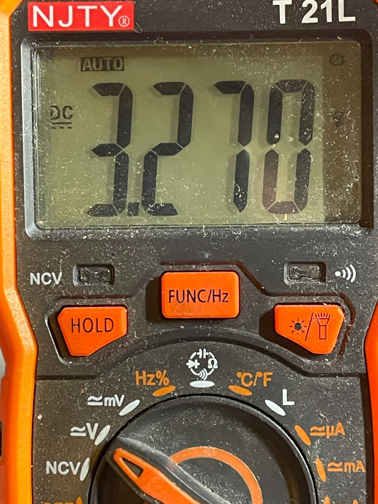
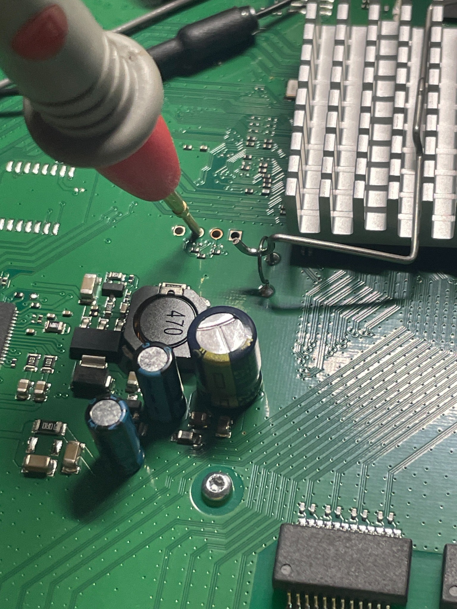
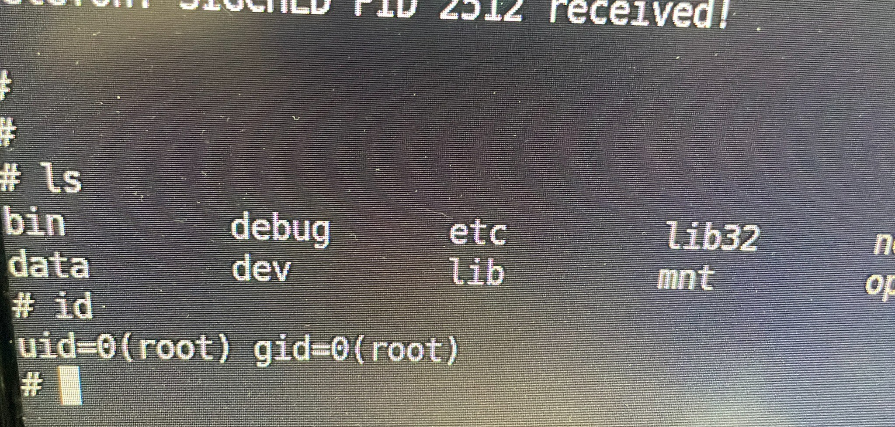
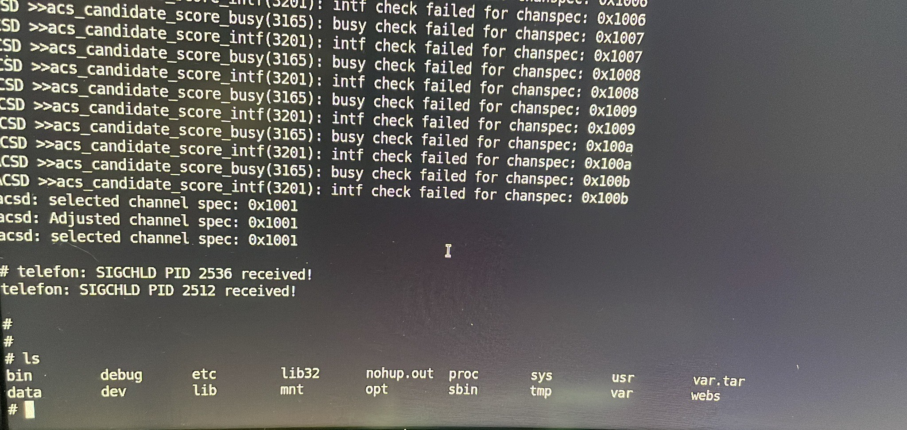
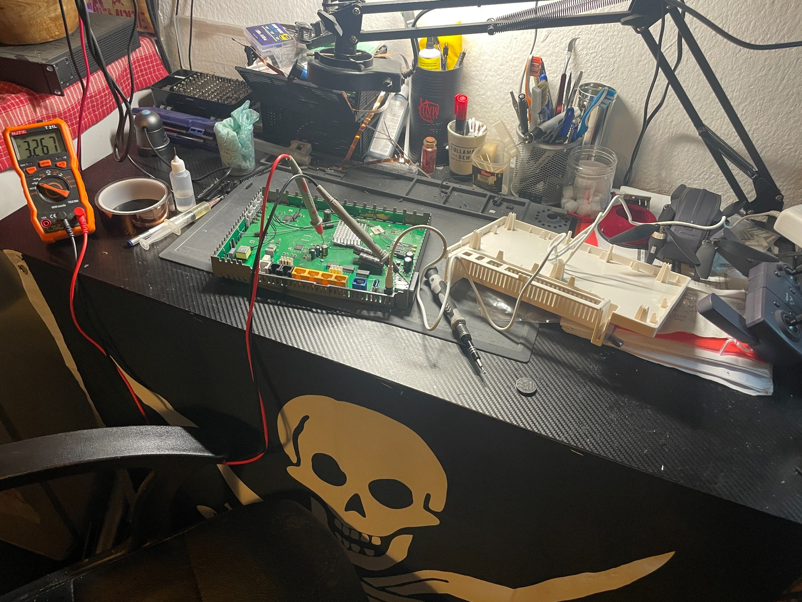

# 🔐 FRITZ!Box Embedded Linux Security Research

**Hardware Security · Embedded Linux · UART · Firmware Analysis · Reverse Engineering**

> 🧪 Independent research on devices I own or am authorized to test. Findings are documented as observed; no remote exploitation or CVE is claimed.



## 👋 Overview

This repository documents hands-on investigation of AVM FRITZ!Box embedded Linux systems. It focuses on physical debugging interfaces, serial console access, boot diagnostics, Linux internals, flash partitions, and firmware reverse engineering.

My goal is to turn experiments into **reproducible technical notes** that demonstrate hardware troubleshooting, security methodology, and embedded Linux knowledge.

## 🔌 Research 01 — UART Console (FRITZ!Box 7582)


Using a **Raspberry Pi Pico** as a serial interface to the tested FRITZ!Box 7582, I established UART communication at **115200 baud, 8N1** and obtained an interactive shell.

### ✅ Verified observations

- Captured output from the embedded Linux boot process.
- Reached an interactive local shell through physical UART access.
- Verified effective root identity with `id`:

```text
uid=0(root) gid=0(root)
```

> 📌 The animation is **illustrative**, not a recording of the actual device session. Physical root-shell access does **not** by itself demonstrate remote code execution, persistence, or a CVE.

## 📸 Real Hardware Evidence — FRITZ!Box 7582

> 📷 The photos below are from my **actual hardware investigation**, unlike the illustrative GIF animations above. The updated UART-pad photo corrects the first label to **GND** (previously marked VCC). All pin labels are working annotations rather than a manufacturer-verified pinout; verify electrical levels and wiring on the actual board.

| 🔬 Router PCB overview | 🔌 Identified UART pad area |
|:---:|:---:|
|  |  |
| Full PCB inspection and pad location | Updated annotations: **GND, RX, TX** (left to right); the fourth pad is not identified |

### 🔧 Raspberry Pi Pico — UART interface setup



*Actual lab setup: Raspberry Pi Pico on an expansion board, alongside the open FRITZ!Box 7582 PCB, with wires connected near the marked UART pads.*

The photographed setup documents the physical connection used for serial-console research. The presence of wires alone does not identify individual signal connections; see [Hardware & UART Notes](docs/hardware-and-uart.md) for the recorded configuration and verification caveats.


| ⚡ Voltage measurement | 🧪 PCB probing |
|:---:|:---:|
|  |  |
| A photographed measurement of approximately **3.270 V DC** at a test point; the precise net is not established by the image alone | Physical probing of a PCB pad during investigation |

| 🐧 Root-shell verification | 📟 UART boot / shell output |
|:---:|:---:|
|  |  |
| Actual `id` output: `uid=0(root) gid=0(root)` | Captured console output, runtime messages, and an `ls` listing |



*🛠️ Lab setup: disassembled router, multimeter, probes, and electronics workbench.*

For the experiment details and evidence limitations, see [Hardware & UART Notes](docs/hardware-and-uart.md).

## 💻 Reproducible UART Bridge — MicroPython

My original lab notes include the **MicroPython UART bridge** that links the Raspberry Pi Pico to an Ubuntu host terminal. The recorded setup uses **UART0 (GP0 TX / GP1 RX)** at **115200 baud, 8N1**.

📄 **[Read the experiment and wiring caveats](docs/uart-bridge.md)** · 🐍 **[View the Pico UART bridge source](scripts/pico_uart_bridge.py)**

The source is adapted from my own project notes and is provided for authorized hardware research. The observed `uid=0(root)` result comes from a local physical console, not a network vulnerability.

## 💾 Research 02 — MTD Flash Layout (FRITZ!Box 7582)


Examined `/proc/mtd` to identify logical flash partitions exposed by the operating system.

| Partition | Label | Size (hex) |
|---|---|---|
| `mtd0` | `kernel` | `0x00400000` |
| `mtd1` | `urlader` | `0x00200000` |
| `mtd2` | `nand-tffs` | `0x00400000` |
| `mtd3` | `reserved-kernel` | `0x00400000` |
| `mtd4` | `nvram` | `0x00020000` |
| `mtd5` | `ubi` | `0x1f0e0000` |
| `mtd6` | `filesystem` | `0x03013000` |
| `mtd7` | `reserved-filesystem` | `0x03013000` |
| `mtd8` | `config` | `0x0020f000` |
| `mtd9` | `nand-filesystem` | `0x17536000` |

> 📝 These are **observed MTD entries**, not a visualization of contiguous physical flash addresses. Some layers can describe overlapping storage regions.

## 🧩 Research 03 — Firmware Analysis (FRITZ!Box 7583)

A **separate** firmware investigation has involved:

- 📦 SquashFS filesystem inspection
- 🧠 MIPS big-endian executable analysis
- 🔎 Embedded libraries, services, and binaries
- 🛠️ Static analysis of firmware components

The 7582 hardware session and 7583 firmware analysis are **distinct experiments**. Results are not interchangeable.

## 🧭 Long-Term Goal — Custom Network-Security Appliance

My original research plan is to explore replacing FRITZ!OS on a **7582** with a custom embedded Linux build, potentially using **Buildroot**. This remains **planned research**; no successful installation or custom kernel boot is claimed. The proposed ARMv7 kernel requires independent hardware compatibility verification.

🗺️ **[View the research roadmap and safety milestones](docs/research-roadmap.md)**

## 🛠️ Tools & Technologies

`Ubuntu` · `Embedded Linux` · `Raspberry Pi Pico` · `MicroPython` · `UART` · `Bash` · `Python` · `MTD` · `UBI` · `SquashFS` · `MIPS`

## 🎯 Next Research Steps

- [x] 📷 Add real photos of the physical lab setup and Pico wiring
- [x] 📚 Document observed UART configuration and hardware notes
- [x] 🧾 Publish sanitized photo evidence of local root-shell access
- [x] 🐍 Add the MicroPython UART bridge and experiment notes
- [x] 🧭 Document the proposed Buildroot appliance goal as future work
- [ ] 📄 Publish additional sanitized text boot logs
- [ ] 🗂️ Expand filesystem and boot-process analysis
- [ ] 🛡️ Assess security implications without overstating findings

## ⚖️ Responsible Research

All research is conducted on hardware I control or am authorized to examine. Public materials omit private keys, credentials, unique device identifiers, and exploit details that require coordinated disclosure. Proprietary firmware images are not redistributed.

## 👨‍💻 Author

**Mag311an** · B.Sc. Engineering Physics · Independent Hardware & IoT Security Researcher

🔗 [GitHub profile](https://github.com/Mag311an)
