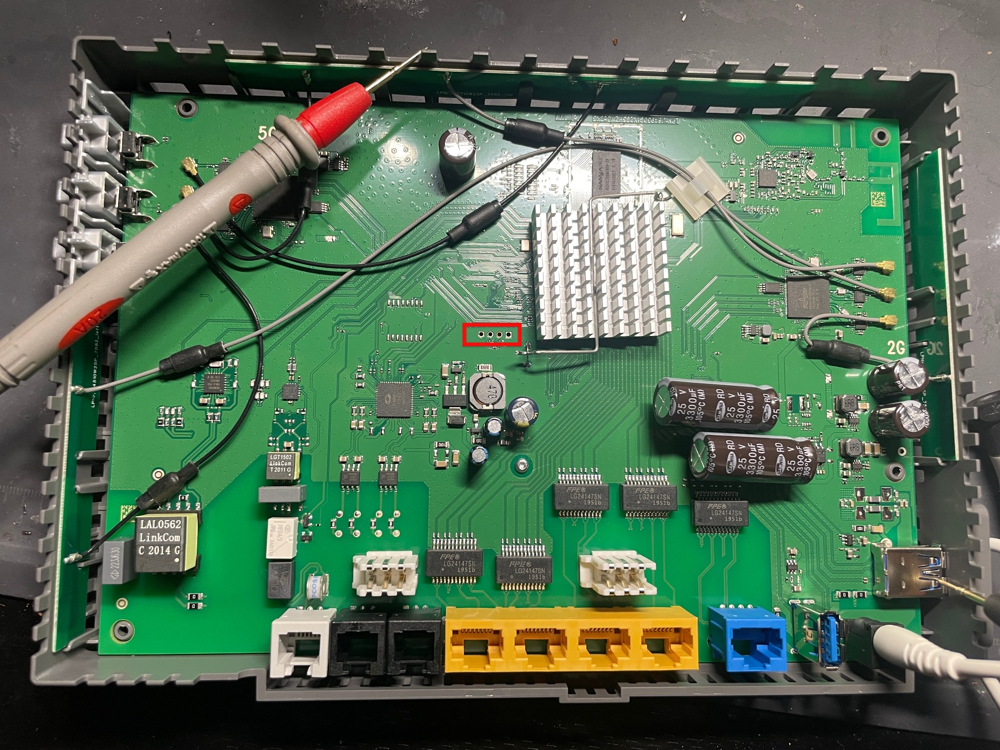
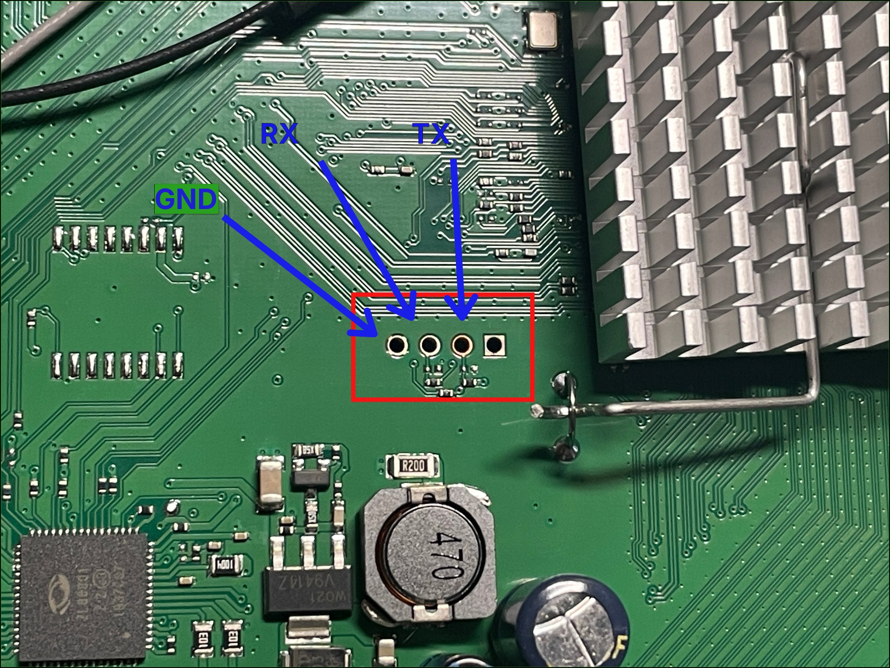
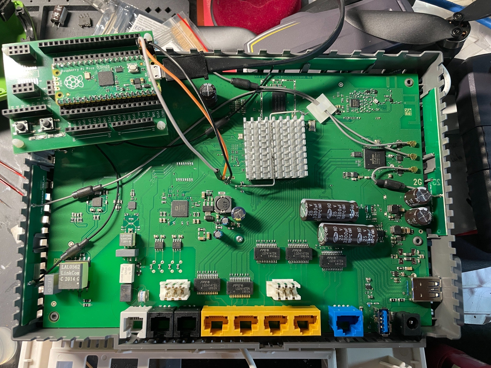
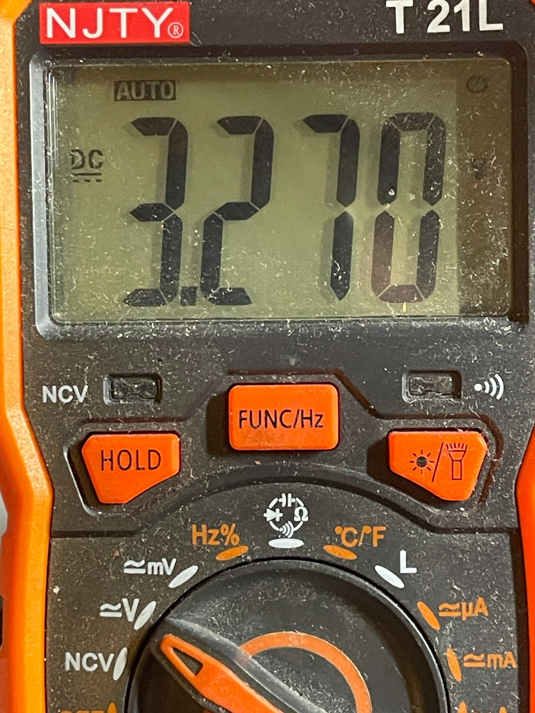
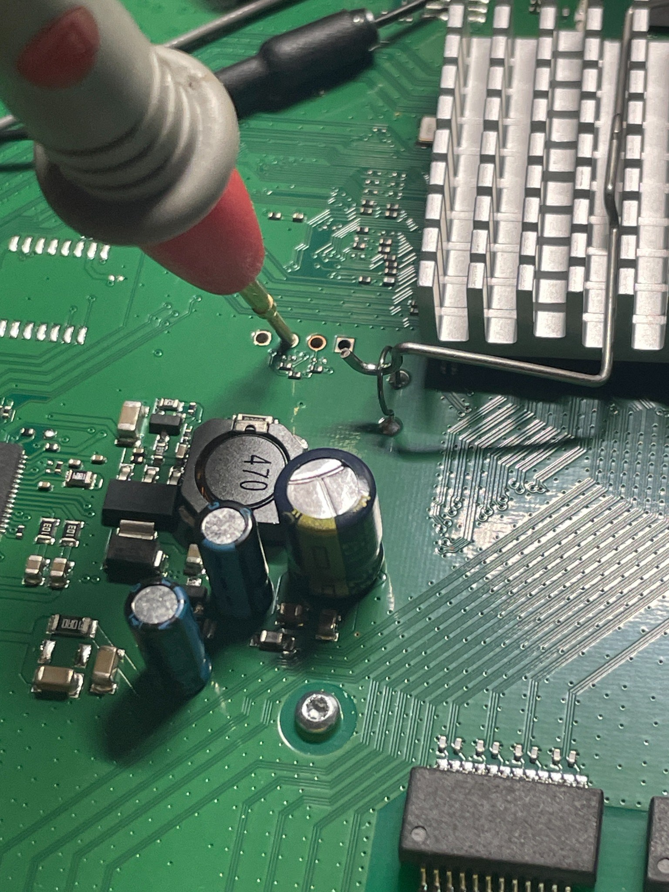
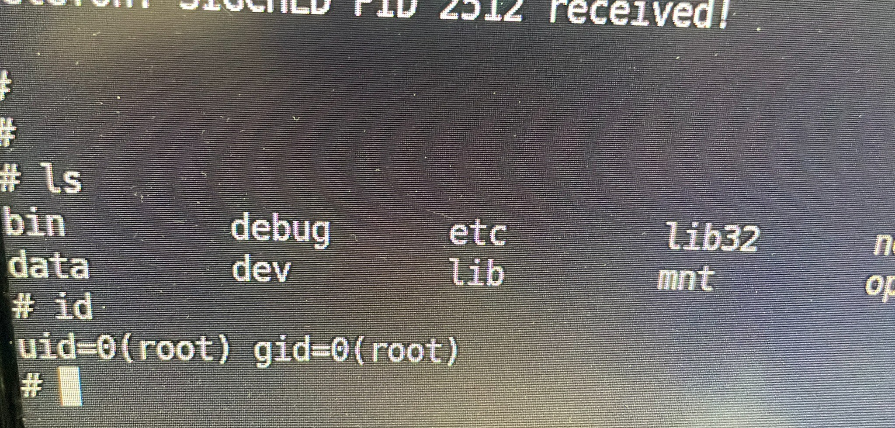
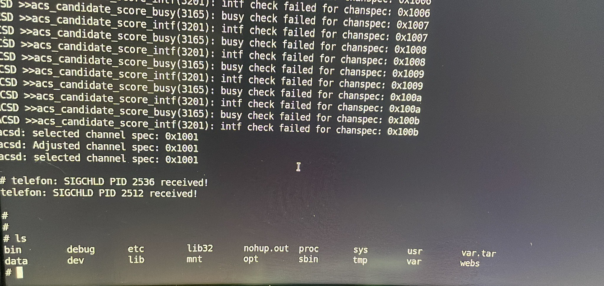
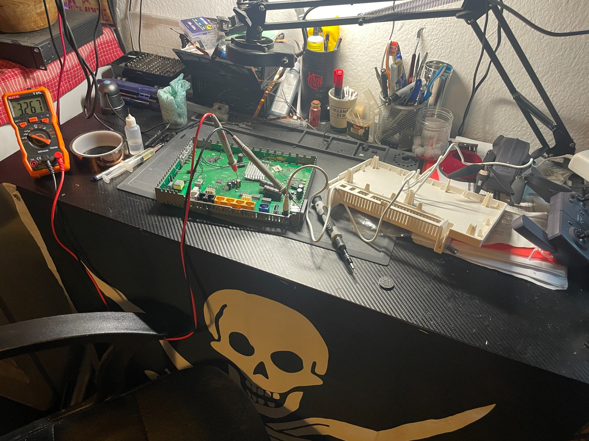

# 🔌 FRITZ!Box 7582 — Hardware & UART Research Notes

## 🧪 Scope and evidence

This page documents physical investigation of a **FRITZ!Box 7582** and observations made through an attached serial console. The images are from my actual experiments. The aim is reproducible research; the pictures do not establish a remote exploit or CVE.

## 🔬 Board inspection



The disassembled PCB contains a group of four unpopulated through-hole pads near the main heatsink. The research photos show that group highlighted.



**Annotation correction:** An earlier image labeled the first pad **VCC**. The updated image instead labels it **GND**. From left to right in this annotated close-up, the four pads are:

| Pad | Working annotation | Evidence status |
|---|---|---|
| 1 | `GND` | User-corrected research annotation; independently verify continuity to known ground before wiring |
| 2 | `RX` | Working UART signal annotation |
| 3 | `TX` | Working UART signal annotation |
| 4 | Unidentified | No assigned function; square-pad geometry alone does not establish identity |

The photo labels are **not a manufacturer-verified pinout**. Signal naming refers to the router-side annotations; wiring to the Pico should be crossed (router TX → Pico RX, router RX ← Pico TX) only after each signal has been electrically confirmed. Do not treat an earlier incorrect VCC annotation as a power-connection instruction.

## 🧰 Raspberry Pi Pico serial interface — actual setup



This updated photo shows the **Raspberry Pi Pico mounted on an expansion carrier** beside the open FRITZ!Box 7582, with jumper wires routed to the pad area. It records a real hardware connection, rather than a conceptual diagram.

Previously recorded serial configuration: **UART0**, Pico **GP0 (TX)** and **GP1 (RX)**, **115200 baud, 8N1**, with MicroPython used on the Pico. The photo does not independently confirm which colored jumper attaches to which GPIO or router pad.

For a verified wiring diagram, label the **router-side TX/RX** separately from the **Pico-side RX/TX**, identify the ground connection, and record the tests that established each assignment. **No Pico GPIO should be connected directly to an unverified supply-voltage pad.**

## ⚡ Electrical investigation



The instrument displays approximately **3.270 V DC**. This documents an electrical measurement, but the photo alone does not confirm which net was measured or the UART's signal voltage on all pins. It must not be used to infer that every pad in the UART cluster is a 3.3 V power or signal pin.



A probe contacting a PCB test point during analysis. The measurement should not be used as a verified UART pinout without checking the exact probe position and ground reference.

### Hardware safety notes

- Power off and disconnect the device before changing signal wires.
- Identify ground and measure voltage levels using suitable test equipment before connecting a microcontroller.
- The Raspberry Pi Pico uses **3.3 V GPIO logic**; do not apply 5 V to its GPIO pins.
- Use a shared ground for UART and cross target TX to adapter RX, and target RX to adapter TX, **only after correctly identifying each pad**.
- Do **not** connect the target's VCC supply directly to the Pico's power rail as a routine UART wiring step.

## 📟 Serial console results

Experiment environment:

| Item | Observed configuration |
|---|---|
| Target | FRITZ!Box 7582 |
| Interface method | Physical UART; Raspberry Pi Pico used as a serial bridge |
| UART configuration | 115200 baud, 8 data bits, no parity, 1 stop bit (8N1) |
| Host | Ubuntu Linux |
| Verified privilege | `uid=0(root) gid=0(root)` |



One local shell session returned:

```console
# id
uid=0(root) gid=0(root)
```

This is strong **local root-shell evidence**, not evidence of remote access or remotely exploitable behavior.



The console also displayed `acsd` channel-selection messages and an `ls` listing of directories including `bin`, `etc`, `proc`, and `sys`. Those messages are observations, not by themselves security vulnerabilities.

## 🛠️ Workbench



The experiment involved physical inspection, voltage checks, and serial communication; the bench photo is provided for provenance.

## 📝 Open questions

- [ ] Record the exact PCB revision and non-sensitive firmware version.
- [ ] Independently confirm each pad's electrical function, with measurements and evidence (including corrected GND label).
- [ ] Describe the tested serial bridge code and provide a minimal sanitized setup example.
- [ ] Document whether UART shell access is the default behavior or depends on device configuration.
- [ ] Publish sanitized logs of the boot sequence and `/proc/mtd` output.

## ⚖️ Responsible disclosure

These notes document experiments on owned or authorized equipment. No remote code execution or confirmed security advisory is claimed. Device identifiers, private keys, and credentials are excluded.
