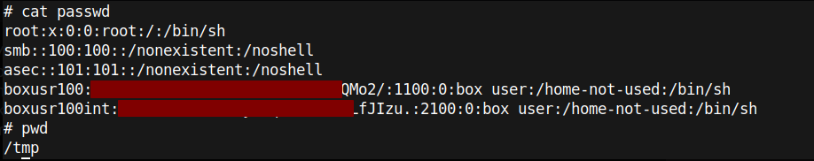
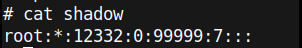

## 👤 Linux Account Enumeration

After obtaining shell access, I inspected local account information to understand the embedded Linux user model.

### `/etc/passwd` inspection

Observed points:

- `root` uses `/bin/sh`
- `smb` and `asec` are configured with `noshell`
- additional service or box-related users are present
- working directory and shell information help identify interactive vs non-interactive accounts

### `/etc/shadow` inspection

Observed points:

- `root:*` indicates password-based login for `root` is disabled
- this suggests that direct password authentication is not enabled for the root account
- shell access in this case was obtained through the physical UART/debug path rather than normal password login

### Notes

Sensitive values were redacted before publication. Screenshots are included for research documentation only.
