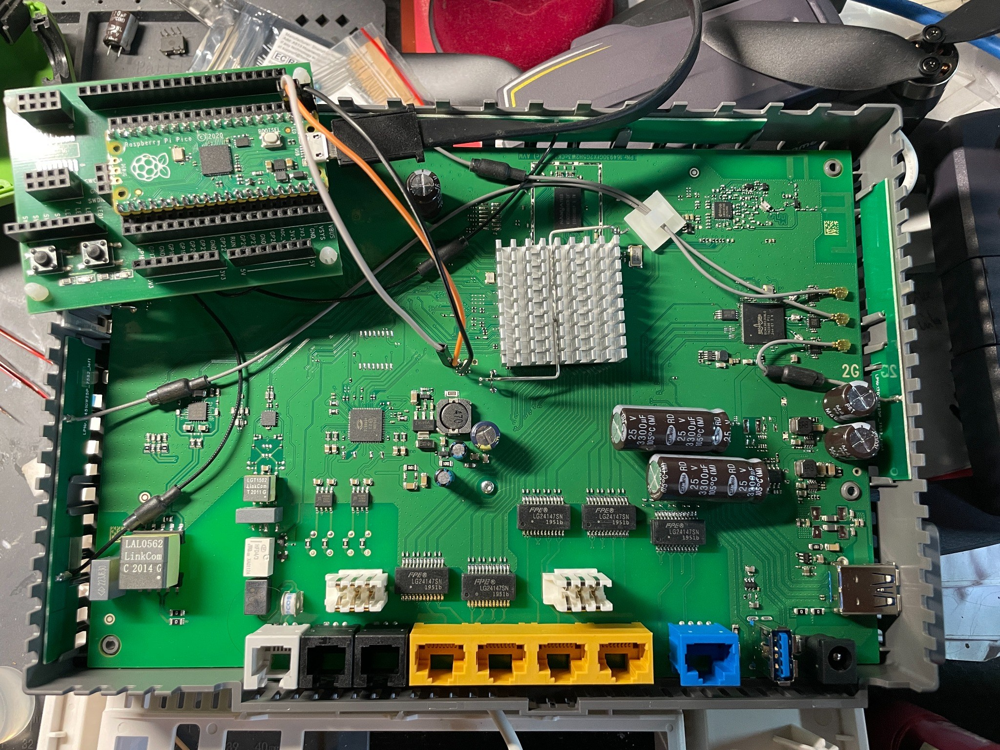
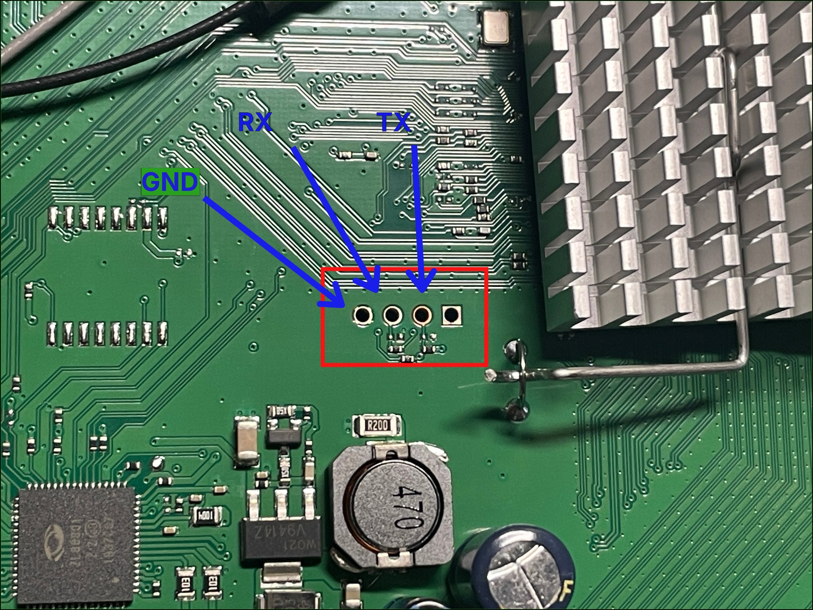
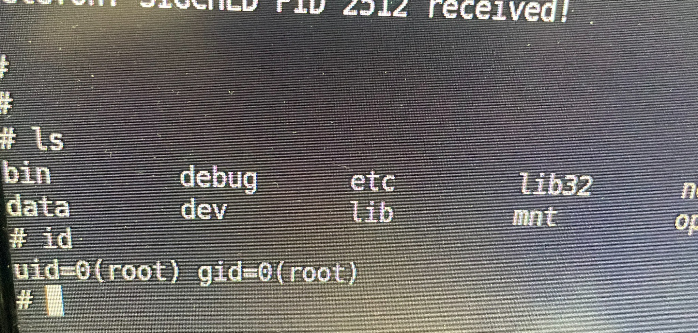

# 🔌 UART Bridge — Raspberry Pi Pico + FRITZ!Box 7582

## Purpose and provenance

This document reproduces the MicroPython serial bridge from my **FRITZ!Box 7582 — Custom Embedded Linux Network Appliance** lab notes. Unlike the animated GIF, the hardware photos and observed root-shell output are real evidence from my setup. The script is a cleaned-up transcription of the code recorded in those notes, not a newly independently tested release.

## Observed setup

| Component | Role |
|---|---|
| FRITZ!Box 7582 | Embedded Linux target, accessed through a physical serial interface |
| Raspberry Pi Pico | UART0-to-host bridge under MicroPython |
| Ubuntu computer | Host terminal over the Pico's USB connection |
| UART speed | **115200 baud, 8 data bits, no parity, 1 stop bit (8N1)** |
| Pico UART0 TX | **GP0** |
| Pico UART0 RX | **GP1** |



## UART pad annotations

The current PCB close-up labels the four pads (left to right): **GND**, **RX**, **TX**, **unidentified**. These are my working router-side annotations, not a manufacturer-certified pinout. Confirm ground and voltage levels before wiring. Router TX connects to Pico RX and router RX connects to Pico TX after their electrical functions have been verified. A shared ground is required. **Do not connect an unidentified VCC pad to the Pico GPIO.**



## Bridge implementation

Source: [`scripts/pico_uart_bridge.py`](../scripts/pico_uart_bridge.py).

The program:

1. Initializes MicroPython `UART(0)` with **115200, 8N1**, `tx=Pin(0)`, `rx=Pin(1)` and an input buffer.
2. Polls the host terminal's standard input for keystrokes and forwards them to the router UART.
3. Reads up to 256 incoming UART bytes per loop and writes a printable representation to the host terminal.
4. Converts Enter into a carriage return and sleeps for 1 ms at the end of each loop.

Example local workflow (adapt the detected serial port and MicroPython environment):

```bash
# Inspect connected serial devices before selecting the Pico
ls /dev/ttyACM*
# With mpremote configured for your Pico, run the MicroPython bridge
mpremote connect /dev/ttyACM0 run scripts/pico_uart_bridge.py
```

The exact host terminal behavior can depend on the `mpremote` version and USB CDC/REPL configuration. These commands are a reference workflow, **not a guarantee that the script works unchanged in every setup**.

## Evidence and scope



Observed serial-console response:

```console
# id
uid=0(root) gid=0(root)
```

This confirms root identity in the **local physical UART session**. It does not establish an exploit path from the network, persistence across reboot, or a CVE.

## Sanitized Linux account notes

The lab notes also discuss account and password-file interpretation: strings beginning with `$1$` conventionally represent **MD5-crypt** hashes, while a `*` in a password field ordinarily means the password cannot be used for normal password authentication. These are interpretation notes, not disclosure of account passwords, hashes or proof of password cracking.

I deliberately do **not** publish raw `/etc/shadow` output, cryptographic hashes, device identifiers or account-specific secrets.

## Next validation steps

- [ ] Record firmware and board revision without publishing unique serial or MAC addresses.
- [ ] Verify each pad with continuity and voltage measurements.
- [ ] Keep a sanitized serial transcript, with command input and responses distinguished.
- [ ] Independently retest the bridge and document the exact host invocation.
- [ ] Characterize the console state before and after boot, and whether access is configuration-dependent.
